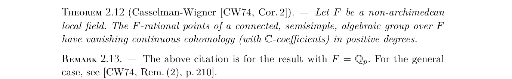

# Source excerpts

Images of theorem statements are included here only when the source's licence allows
redistribution. Every other source is linked, with exact theorem and page numbers, in
[`../REFERENCES.md`](../REFERENCES.md); readers can check those statements at the links given there.

## Casselman–Wigner (axiom `casselman_wigner`)

*Excerpt from:* D. Fisher, M. Mj and W. van Limbeek, "Commensurators of normal subgroups of
lattices", *Journal de l'École polytechnique — Mathématiques* **11** (2024), 1099–1122, p. 1110
(Theorem 2.12 and Remark 2.13). https://doi.org/10.5802/jep.274. © The authors, 2024. Licensed
under [CC BY 4.0](https://creativecommons.org/licenses/by/4.0/). Changes: page cropped to the
theorem.

This is a published restatement of Casselman–Wigner, *Invent. Math.* 25 (1974), §4, Corollary 2
(p. 209). The audit also read the original, which states `Hⁿ(G, ℂ) = 0` for `n ≠ 0` (see
`../AXIOM_AUDIT.md`, row 6).
